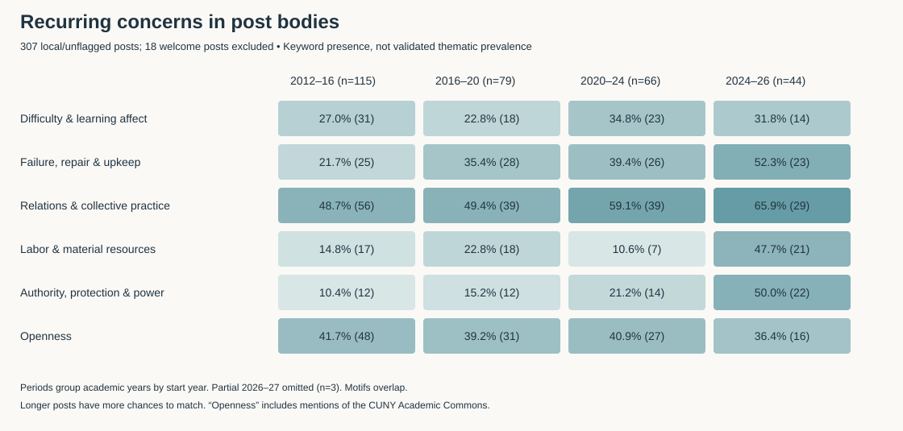

# Tagging the Tower: a deeper reading

The post bodies suggest a durable intellectual project: making digital scholarship answerable to the people who learn it, maintain it, and live with its consequences. The vocabulary changes—from scholarly identity and collaborative tools to data ethics and AI—but many underlying questions persist. This is an interpretive finding grounded in examples, not a claim that all posts share one position.

This extension combines exploratory searches across all 325 local/unflagged published posts with closer readings of selected texts. Eighteen recurring welcome messages are excluded from body-text comparisons, leaving 307 posts. Curated items and drafts remain outside these comparisons. The remaining corpus still includes tutorials, announcements, recruitment, participant testimony, and essays; these are not interchangeable genres. Post-level contexts and search rules are supplied for inspection.

## 1. The archive repeatedly questions what counts as success

Laura Kane's *What does it mean to be a “Digital Scholar”?* (2012) asks whether success means visibility, citation, or tool creation, then shifts attention to overcoming specific scholarly obstacles. Erin Glass's *tech versus culture* (2014) argues that software cannot manufacture the interest and organization needed for collaboration. Hannah Aizenman's *Which digital tool should I use?* makes objectives, constraints, existing skills, and institutional support central to choosing a tool.

That question reappears in the recent AI posts. Eunah Cho distinguishes increased activity from better outcomes and judgment in *When AI Makes Us More Active, We Risk Being Less Wise*. Ian G. Williams questions the adequacy of perpetual skills acquisition in *Thoughts on Situating AI Literacy*. These later texts change the object of scrutiny, but continue the earlier concern with how technological success is defined.

**Interpretation:** a useful organizing axis is how authors define a good outcome: more output, usable research, greater confidence, stronger relationships, improved judgment, or more equitable conditions. This axis reveals continuity that tool-based topic categories hide.

**Question:** When posts describe a technology as successful, what evidence supports the claim? Code claimed outcomes separately from demonstrated outcomes: the author's experience, participant testimony, systematic evaluation, or an aspiration. A change in the language of success does not establish a change in actual program outcomes.

## 2. Emotional difficulty is part of the teaching method

The recurring learner is often curious, anxious, stuck, or unsure of belonging. In *The Luddite-Technophile Spectrum* (2012), Erin Glass introduces technological excitement and anxiety together. *On Being Stuck* describes troubleshooting as a skill and patience as something a digital project requires. Julia Lipkins's 2016 bootcamp reflection describes learning across unequal starting skills and the importance of practical and emotional support. Leanne Fan's *Death of a Project* (2023) makes relinquishing an ambitious project discussable rather than simply hiding it from the record.

Difficulty/confidence terms occur in 31/115 non-welcome local posts in academic years 2012–13 through 2015–16 (27.0%) and 14/44 in 2024–25 through 2025–26 (31.8%). These are broad lexical signals: fear may concern social harm rather than learning, and confidence may concern a method. They support further reading, not a prevalence estimate for anxious learners.

**Interpretation:** first-person vulnerability can lower the threshold for participation. Fellows present themselves as people who encounter uncertainty, not only as experts who dispense solutions. However, a supportive narrative can still leave structural constraints unaddressed.

**Question:** Do these stories end with “persist and master it,” “ask for help,” “change the project,” or “decline the technology”? Compare those resolutions and ask whose time, disability, employment, caring responsibilities, or institutional support are recognized. Non-participants' experiences are absent from participant testimonials.

## 3. Maintenance and endings deserve equal attention to making

Tutorials often foreground building something. The archive also repeatedly describes debugging, changing tools, preserving materials, and deciding what to abandon. Aizenman's tool-choice post documents revised decisions as the project develops. *When Servers Burn* (2023) treats preservation as material, selective, and vulnerable. *Death of a Project* treats stopping as a reasoned response to scope, life changes, and research priorities.

Failure/repair/upkeep markers appear in 25/115 posts in 2012–16 (21.7%), 28/79 in 2016–20 (35.4%), 26/66 in 2020–24 (39.4%), and 23/44 in 2024–26 (52.3%). This dictionary combines distinct ideas: a project's failure, software maintenance, archival preservation, and environmental sustainability. The increase should be disaggregated before describing a historical shift toward maintenance. Recent posts are also longer.

**Interpretation:** the archive contains a counterweight to the successful-project showcase. It can document the labor required after an initial build, and the value of work that does not culminate in a finished product.

**Question:** What survives after fellows leave? Link posts to project repositories and surviving sites, then examine handover, documentation, funding, platform migration, and deliberate retirement. A broken link alone is not proof of project failure; a functioning site is not proof of active maintenance.

## 4. Openness becomes a question of governance

Andrew G McKinney's *Don't Blame the Technology* (2013) contrasts proprietary instructional systems with open, interactive environments and situates the comparison within teaching labor. The early language of opening connections has a later counterpart in Christopher Colon's *What about Public Presence?*: scholarly visibility should be accompanied by control over one's data and institutional alternatives to proprietary platforms.

Parisa Setayesh's *The Walled Garden* makes the tension explicit: boundaries may protect a shared knowledge environment rather than merely exclude people. Maggie Schreiner's *Ethical Metadata for Digital Projects* draws attention to consultation, descriptive authority, and appropriate treatment of community materials. These texts do not all advocate the same arrangement, but they complicate a simple equation between greater circulation and greater justice.

**Interpretation:** the consequential question becomes who sets the terms of participation, visibility, reuse, and protection. Open-source software, public access, participatory governance, and permission to extract data should be coded as different things.

**Question:** When do authors recommend openness, and when do they recommend restriction, refusal, or consent? Compare whether the post centers an institution, researcher, platform, or community as the decision-maker. Do not use mentions of the CUNY Academic Commons as automatic evidence of an argument for openness.

## 5. Representation is a common problem across maps, metadata, alt text, and AI

Anna Corbett's *Mapping and its Discontents* argues that cartographic choices carry histories and consequences. Silvia Rivera Alfaro's *Geochicas* explicitly follows that post and moves toward feminist collective mapmaking. Schreiner's metadata writing examines how descriptive systems influence discovery and interpretation. Rivera Alfaro's *Reflecting on Alt Text and its Ethics* treats description as situated meaning-making and an integral part of composition. Setayesh's *Human in the Loop* insists that pattern detection still requires interpretation and accountability.

**Interpretation:** these are connected interventions into the authority of representation. Each asks how something becomes legible through an interface, whose categories organize it, and what remains outside the representation. AI enters a conversation already visible in maps and archives; it does not introduce the problem from scratch.

**Question:** Follow the same analytic sequence across methods: who supplies the categories, who is described, who can contest the description, and what consequences follow? Look for tutorials where these decisions are taught through specific technical steps, as well as essays where they are discussed abstractly.

## 6. Refusal and selective adoption coexist

The archive should not be assigned a single pro- or anti-technology position. Glass's early Luddite discussion explores participating critically rather than abandoning digital life. Corbett's *Hidden Costs of AI and the Case for Luddite Thinking* (2025) uses refusal to foreground work and environmental consequences. Rivera Alfaro's *The smartwatch dilemma* makes refusal a response to biometric extraction and individualized health responsibility.

Nicole Walker's *Vibe Coding My Way Out of a Teaching Problem* (2026) presents a different situated judgment: AI assistance made a classroom intervention possible on the timescale of a current semester. The post acknowledges the tension between using AI and helping students value their own thinking. This is the writer's account of benefit, not an independently evaluated causal result.

**Interpretation:** the disagreement is productive. Authors weigh different dependencies, harms, time horizons, and possibilities. Reducing these positions to a sentiment score would erase much of the argument.

**Question:** What makes a use acceptable or unacceptable? Code the actor, task, perceived benefit, dependency, affected population, alternative, and proposed limit. Distinguish refusing a workplace mandate from refusing every personal use, and distinguish using an AI system to build a learning activity from asking students to outsource that activity.

## 7. Community is infrastructure, and the public extends beyond campus

McKinney's *Breaking Out of the Silo* (2013) describes disciplinary and geographic fragmentation and values spaces that allow people to meet and share skills. Glass's collaboration post distinguishes a tool's affordances from the human organization needed to make them useful. The collective 2025 *Conversations in Digital Scholarship* reflection records a deliberately organized exchange among scholars. Williams's two CityCamp posts (2026) examine participation, meeting formats, and connections between civic work and academic practices.

Relations/collective-practice markers appear in 56/115 posts in 2012–16 (48.7%) and 29/44 in 2024–26 (65.9%). Labor/material-resource markers appear in 17/115 (14.8%) and 21/44 (47.7%); authority/protection/power markers in 12/115 (10.4%) and 22/44 (50.0%). These broad searches include incidental uses and cannot establish ideological change. The close readings suggest useful distinctions within the larger patterns.

**Interpretation:** convening, facilitating, translating, and connecting people are substantive digital work. The presence of civic technology in fall 2026 has antecedents in earlier concerns about public connection, labor, feminist mapping, and community knowledge. Two CityCamp posts by one author remain a small cluster, not evidence of a completed institutional turn.

**Question:** Who is the imagined public in each post: graduate students, CUNY teachers, researchers, neighborhood organizations, workers, or a generalized public? Track concrete partnerships and reciprocal contributions. Avoid equating a public-facing website with participatory public-interest work.

## 8. Language and discovery shape the visible archive

In *Doing humanidades digitales at CUNY*, Rivera Alfaro explicitly rejects treating Spanish terminology as a mere translation. The post describes scholarship across languages, geographies, and communities and builds a resource to make that work discoverable. This is also a warning about the current analysis: English keyword dictionaries can systematically under-detect multilingual arguments and culturally specific vocabularies.

**Question:** Which work becomes visible under “digital humanities,” “humanidades digitales,” digital scholarship, or particular methods? Compare language, category assignment, links, and audiences. A corpus restricted to this WordPress category cannot represent all GCDI-related publishing or everything fellows do in other languages and venues.

## The blog is also a record of intellectual exchange

Using links recovered from post bodies, I identified **89 distinct source–target post pairs from 63 non-welcome local posts**. Of these pairs, **38 connect different academic years**, and **46 have no credited author in common**. These two groups overlap. They are not necessarily citations of intellectual influence: links can provide background, promote an event, or connect a series. Older URL forms, missing posts, and unresolved attributions can also hide relationships.

One especially clear relationship is *Geochicas* explicitly building on *Mapping and its Discontents*. A useful next analysis would distinguish continuation, disagreement, acknowledgment, tutorial prerequisite, and promotional reference. Compare these relationships with overlapping cohort memberships to investigate how ideas persist through turnover. The counts show observable textual connections, not proof that fellowships caused knowledge transfer. Link dates are as exported; later edits can point to newer material.

## Attribution corrections from this closer reading

The first pass missed three explicit body credits. The inventory and contributor tables now credit Julia Lipkins for *Finding Your Way Through the Obstacle Course of Code* and Lavelle Porter for *Participation, Collaboration, and an Opportunity to Find Out How Much We Can Do*, both posted through Jennifer Tang's account. The 2025 *Conversations* reflection now records eleven collective authors rather than assigning sole authorship to the posting account, Tuka Al-Sahlani. That collective includes people beyond the eight-person Digital Fellows roster, reinforcing the need to distinguish fellowship programs and collaborators.

These corrections do not change published/local/curated post counts or the title/tag theme counts. They do change who receives writing credit. The broader inventory remains provisional where explicit authorship evidence has not been recovered; the initial automated guest-byline rule was not exhaustive.

## Priorities for a more rigorous next study

| Priority question | What to do | What would challenge the interpretation? |
|---|---|---|
| Is the shift toward power and labor substantive or an artifact of genre and length? | Human-code a stratified sample across periods, genres, and authors; compare matched genres and word-length bands | The difference disappears after separating essays from tutorials and notices |
| How does the archive teach judgment? | Code the decision, alternatives, criteria, uncertainty, and proposed action in tool-choice and AI posts | Decision-making appears only in a few unusually reflective writers |
| Does vulnerability widen participation? | Compare narrative resolutions and who speaks; seek participant interviews and non-completer perspectives | Testimony normalizes persistence while excluding people unable to supply the time or resources |
| How do ideas travel across cohorts? | Annotate internal link functions and compare author overlap, chronology, and semester rosters | Most connections are promotional or retrospective edits rather than substantive engagement |
| Who sustains digital projects? | Follow project histories, documentation, handovers, and maintenance labor | Visible preservation language does not correspond to documented support or continuity |
| How does GCDI connect to public-interest work? | Track named partners, publics, decision-making roles, and reciprocity across posts | Public language is broad while concrete work remains entirely campus-directed |

A first validation sample could include 48 non-welcome local posts: 12 from each of the four complete period groups, split across short/long texts and practical/reflective genres, with author concentration checked. Use two readers where feasible, reconcile disagreements, and refine the codebook before extending claims to the archive. With incomplete early rosters, compare authors and documented team snapshots rather than inventing per-fellow productivity rates.

## How to read the measurements

Period labels group academic years by their start year: 2012–16 means 2012–13 through 2015–16, and 2024–26 means 2024–25 and 2025–26. Partial 2026–27 has only three non-welcome local posts and is excluded from the displayed comparison. Counts are of posts with at least one lexical match, not word frequencies, thematic intensity, or author agreement. They are not adjusted for genre, author, or length.

Median cleaned post length rises from 603 words in 2012–16 to 833.5 in 2024–26, about 38%. Longer texts have more opportunities to trigger every dictionary. Cleaning removes HTML, URLs, selected shortcodes, and recognizably headed bibliographies, but some captions, quoted material, references, notices, or boilerplate may remain. A post's vocabulary can represent an argument it criticizes. The historical, scientific, or causal claims made by post authors have not been independently fact-checked for this discourse analysis.

New files: `body_text_signals.csv`, `body_text_evidence.csv`, `body_text_summary.csv`, `body_text_audit.json`, `internal_post_links.csv`, `body_text_patterns.svg`, and `deeper_text.py`. They complement the corrected post inventory and original report. The evidence table provides short contexts for matches; it is not a substitute for reading each full argument.
