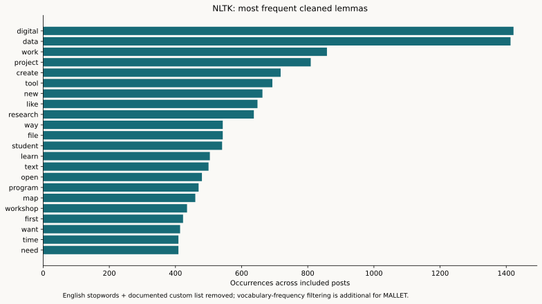
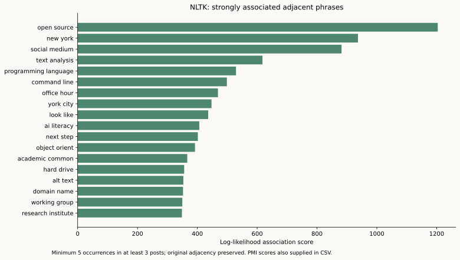
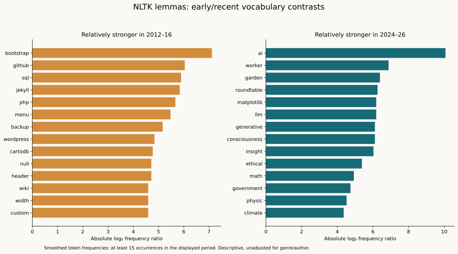
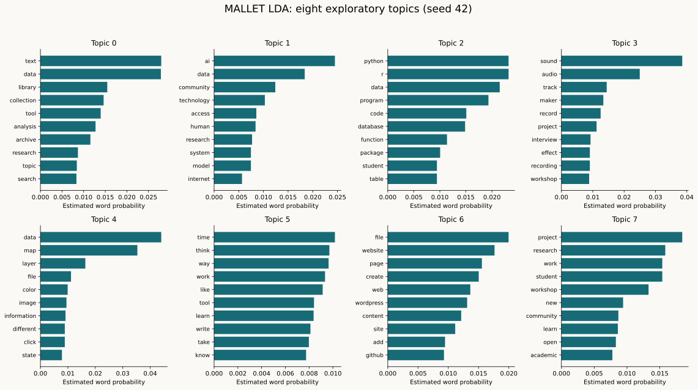
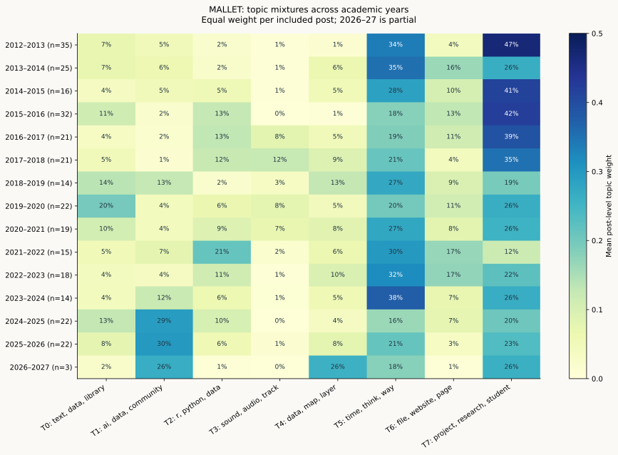
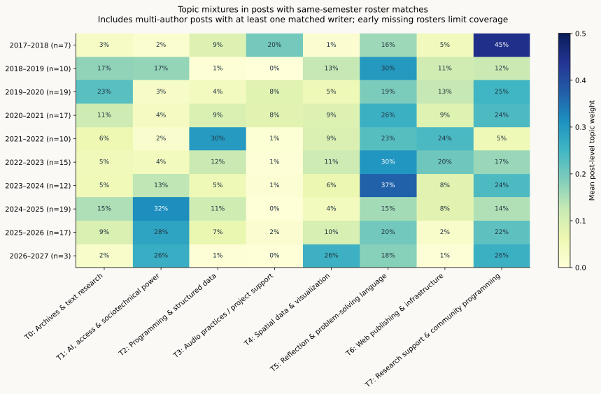
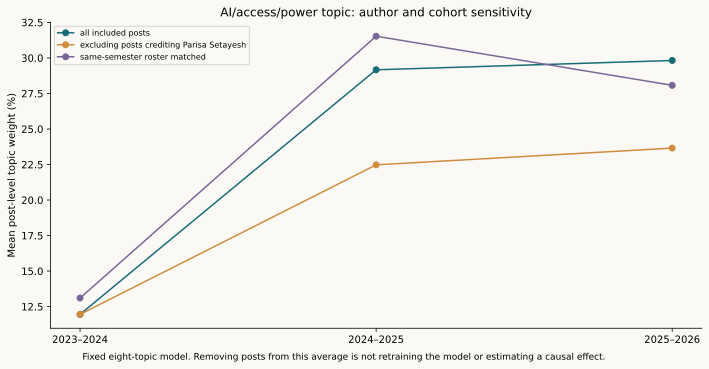
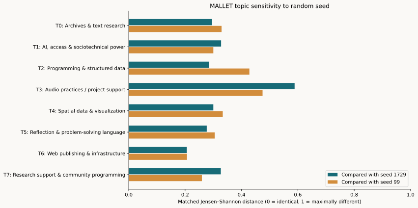

## Historical membership extension · November 2, 2026

The [GCDI People directory](https://gcdi.commons.gc.cuny.edu/people/) now supplies separately documented academic-year role histories. [Explore the historical role matrix](FELLOWS_HISTORY.html) or read the [methodology](membership/README.md). Ian confirmed Margaret/Maggie Schreiner and Anna Schlenz/Anna Corbett; original source names remain inspectable.

Earlier signed-roster tables remain a preserved baseline. The topic and word views, index/network and thematic charts now offer alternative evidence bases: original signed lists, reviewed signed names, dated Digital Fellow intervals, any dated GCDI role, or a combined Digital Fellow definition. Of 325 local records, 147 match the original signed lists, 237 match dated Digital Fellow intervals, and 246 match the combined basis. Of 299 modeled posts, the corresponding counts are 129, 216 and 223. These match **recorded credits**, including provisional accounts; they do not verify additional bylines. Apply the separate source-supported filter when needed.

The directory also changes how unmatched or guest credits should be interpreted: a guest byline does not establish that someone was outside GCDI. For example, the directory lists Ian Williams as a Social Media Fellow in 2022–2026; that is a different role from a dated GC Digital Fellow interval. Current roles are undated snapshots and are not backdated. All 430 records and their authorship decisions remain intact. No model fitting or word cleaning was rerun.

# NLTK and MALLET analysis of Tagging the Tower

**Attribution update, November 2, 2026:** The [complete coverage ledger](ARCHIVE_COVERAGE.html) distinguishes source-supported, declared-only and unresolved credits for every record. All 421 published records have a model inclusion/exclusion decision; 299 are fitted. Source-supported subsets in the browser recompute summaries of the saved weights and words without retraining.  Current writer labels and author filters follow the corrected source inventory. Posting-account-only labels remain provisional, including historical imported records. See [the source-credit audit](ATTRIBUTION_REVIEW.html). The fitted words and per-post topic weights are unchanged.

**Attribution update, November 1, 2026:** Writer credits and cohort matches have been corrected from body bylines and signed contributions. Roster-subset summaries use those corrected matches. The 299-post cleaned corpus and fitted topic weights remain frozen; this is not a new NLP fit. See the [source-based correction review](ATTRIBUTION_REVIEW.html).

Interactive companion: [explore the charts](interactive_explorer.html), or read the [interactive usage and code guide](INTERACTIVE_GUIDE.html).

Both packages were actually run locally: NLTK 3.10.4 for preprocessing, frequency distributions, collocations, and concordances; MALLET 2.0.8 for five Gibbs-sampled LDA models. Python launches MALLET's official Java classes directly. No other library's LDA model is substituted for MALLET.

## Cleaned corpus

The published category corpus contains 421 posts. The main model excludes 96 curated/source-linked items, 18 welcome/roster messages, and 8 posts with fewer than 30 cleaned tokens. That leaves **299 posts**. Drafts and non-post items never enter this pipeline. The eight short items remain in the audit inventory; their exclusion does not mean their subject matter is unimportant.

The retained bodies contain **263,763 word tokens before stopword filtering and lemmatization**, **137,094 cleaned tokens**, and **123,513 tokens in the final MALLET vocabulary of 3,940 lemmas**. The first count follows HTML/reference cleaning, so it is not a count of every word in the original XML. The final count additionally removes vocabulary found in fewer than three documents or at least 80% of included documents.

Cleaning strips HTML/navigation, URLs, email addresses, selected WordPress shortcodes, recognizable reference sections, and opening credit lines. NLTK applies English sentence segmentation, word tokenization, grammatical tagging, and WordNet lemmatization. The stoplist combines NLTK English stopwords with a documented custom list of site labels, markup fragments, and low-specificity terms. AI and R are retained despite their short length. No thematic dictionaries or earlier theme labels are supplied to MALLET.

The pipeline also tests for exact repeated paragraphs of at least 30 words in five or more eligible posts. It found **zero** after welcome-message exclusion, so it made no removals under that rule. Near-duplicate or paraphrased boilerplate can remain. Readable text is preserved separately from filtered text, including negation, for interpretive checks. Stopwords and all exclusions are supplied for review. This English-centered preprocessing is less suitable for multilingual passages and technical code; meaningful rare terms can be lost under the frequency threshold.

## What NLTK adds

The associated phrases identify multiple kinds of discourse: technical methods, institutional settings, organized support, and recent conceptual concerns. The phrase analysis uses lemmatized words adjacent within sentences **before** stopword filtering, then filters out candidates containing excluded terms. It therefore does not create artificial phrases by joining across removed stopwords. Punctuation is removed, so lexical adjacency can span punctuation within a sentence. Candidates require at least five occurrences across three posts. The chart ranks log-likelihood association; the data also include PMI, frequency, and document counts, following the [NLTK collocation workflow](https://www.nltk.org/howto/collocations.html).

| Lemmatized phrase | Occurrences | Posts |
|---|---:|---:|
| open source | 117 | 60 |
| new york | 79 | 48 |
| social medium | 78 | 29 |
| text analysis | 75 | 30 |
| programming language | 51 | 32 |
| command line | 46 | 26 |
| office hour | 34 | 21 |
| york city | 35 | 23 |
| look like | 63 | 43 |
| ai literacy | 37 | 6 |
| next step | 41 | 23 |
| object orient | 30 | 4 |
| academic common | 40 | 31 |
| hard drive | 27 | 5 |
| alt text | 30 | 3 |

The displayed “social medium,” “academic common,” and “office hour” are normalization artifacts of plural lemmatization. Counts should be interpreted as normalized expressions. PMI's highest-scoring pairs also include scholars' names; this is why a high phrase score is not automatically a substantive theme.

**Concentration matters:** “AI literacy” appears 37 times in six posts, while “alt text” appears 30 times in three. A concept can be salient within a small conversation without being widespread across the blog. “Open source” occurs 117 times across 60 posts, indicating a broader distribution under these rules.

Early vocabulary is relatively rich in Bootstrap, Jekyll, PHP, SQL, and WordPress; recent vocabulary includes AI, workers, LLMs, and generative systems. This combines changes in software, genre, authors, and argument. It does not mean that databases or web publishing stopped being part of fellows' work. The comparison uses smoothed relative token frequencies, not a statistical significance test, and requires at least 15 occurrences in the displayed period. Periods refer to academic-year starts: 2012–16 covers 2012–13 through 2015–16; 2024–26 covers 2024–25 and 2025–26. Partial 2026–27 is excluded from that contrast.

The supplied NLTK concordances retain context for failure, openness, labor, community, AI, refusal, and care. They help distinguish an author's endorsement from a position the post criticizes. Neither isolated word counts nor an unsupervised topic model supplies that distinction.

## MALLET's eight-topic overview

Each whole post is a document. The overview uses eight topics, random seed 42, 1,000 iterations, one thread, initial total alpha 1.0, and beta 0.01. Hyperparameters are optimized every 50 iterations after a 200-iteration burn-in. The shared input and all output topic mixtures are retained. Topic weights are mixtures: **29% mean weight is not a claim that 29% of posts belong exclusively to that topic.**

Labels below are human interpretations of top words and representative documents. MALLET generates numbered word distributions, not these labels. Topics 5 and 7 capture substantial general language and genre; Topic 3 combines audio with some project-support/funding vocabulary. These limitations are part of the result.

| Topic | Interpretive label | Mean weight per post | Leading words |
|---|---|---:|---|
| T0 | Archives & text research | 8.3% | text, data, library, collection, tool, analysis |
| T1 | AI, access & sociotechnical power | 8.7% | ai, data, community, technology, access, human |
| T2 | Programming & structured data | 8.1% | r, python, data, program, code, database |
| T3 | Audio practices / project support | 3.1% | sound, audio, track, maker, record, project |
| T4 | Spatial data & visualization | 5.7% | data, map, layer, file, color, image |
| T5 | Reflection & problem-solving language | 25.7% | time, think, way, work, like, tool |
| T6 | Web publishing & infrastructure | 9.6% | file, website, page, create, web, wordpress |
| T7 | Research support & community programming | 30.7% | project, research, student, work, workshop, new |

| Topic | Highest-weight example | Credited writer(s) | Topic weight |
|---|---|---|---:|
| T0 | Working with HathiTrust Data - Part 1 | Param Ajmera | 88.6% |
| T1 | Rethinking Participatory Mapping as a Justice-Oriented Practice | Parisa Setayesh | 84.9% |
| T2 | Reordering Graphs in ggplot Plot: A Step-by-Step Guide | Chen Zhou | 82.2% |
| T3 | Basic Audio Editing with Audacity | Di Yoong | 76.3% |
| T4 | Using raster spatial data in R | Rilquer Mascarenhas | 81.4% |
| T5 | Think Like a Coder: Introduction to Algorithms Part 2 | Gregory Hartmann | 87.6% |
| T6 | Learn Bootstrap Part 3: Customize Bootstrap and Add a Header | Sam O'Hana | 95.6% |
| T7 | Digital Fellows Fall Workshops Announced | Patrick Sweeney | 95.8% |

The highest-weight examples show that the model recovers recognizable methods: HathiTrust/text research, SQL and programming, Audacity/audio, spatial data, and web publishing. The highest-ranked AI/access/power examples are heavily concentrated in Parisa Setayesh's writing. This makes author specialization an essential check on any cohort interpretation.

## Academic years and cohort evidence

The AI/access/power grouping has an average post-level weight of **12.0% in 2023–24**, **29.2% in 2024–25**, and **29.8% in 2025–26**. This supports increased prominence of sociotechnical questions in the recent texts, while also showing why the grouping cannot be read as an AI-only count: its strongest example is a participatory-mapping post.

Web publishing has relatively high weight in 2013–14 and returns in 2021–23. Programming/data is relatively prominent in 2015–18 and 2021–22. Archives/text peaks in 2019–20, including the HathiTrust series. These patterns invite investigation of author specialties and series rather than a single irreversible progression from tools to critique. The large reflective and program-support topics also indicate that publication genre matters.

Each post receives equal weight in the heatmap's annual mean, while the model itself is trained on tokens and is therefore influenced by long documents. Token-weighted annual estimates are supplied separately. Rounded rows need not total exactly 100%. Summer posts remain assigned to August–July academic years; membership confirmation still requires the earlier same-semester evidence. Partial 2026–27 has only three included posts and should not be treated as a settled trend.

The cohort view includes posts with at least one credited writer matched to the same-semester roster. It excludes unconfirmed writers; it does not establish that those writers were not fellows. It also includes collective posts containing both matched and unmatched writers. No author is assigned an individual share of a collective post's topic mixture. Missing early rosters severely limit that view, and no posts-per-fellow productivity rate is calculated.

As an additional sensitivity check, removing all posts crediting Parisa Setayesh from the annual average reduces Topic 1's recent weights to **22.5% in 2024–25** and **23.7% in 2025–26**. That remains above the 12.0% average in 2023–24, so the observed increase is not confined to her posts. The same-semester roster-matched averages are **31.5%** and **28.1%** in the two recent complete years. These are aggregation checks on the fixed model, not retrained leave-author-out models or causal estimates.

## How sensitive are the topics?

The pipeline runs six-, eight-, and ten-topic models at seed 42 and repeats the eight-topic model at seeds 1729 and 99. For each model, mean document-level NPMI measures co-occurrence among its ten leading words per topic. Diversity is the fraction of unique words among those top-ten lists. These are in-sample descriptive diagnostics, not held-out predictive evaluation or validated measures of human interpretation.

| Topics | Seed | Mean document NPMI | Top-ten diversity |
|---|---|---:|---:|
| 6 | 42 | 0.141 | 83.3% |
| 8 | 42 | 0.146 | 83.8% |
| 10 | 42 | 0.161 | 87.0% |
| 8 | 1729 | 0.138 | 81.2% |
| 8 | 99 | 0.153 | 88.8% |

The ten-topic run has the highest NPMI of these trials. It separates AI/research/ethics from civic/community/access language and separates programming from databases more clearly. The eight-topic model is retained as the preselected overview, **not declared optimal**. Its mixtures should not be combined with ten-topic mixtures as though topic numbers had the same meaning.

The seed comparison matches topics by minimizing Jensen–Shannon distances between their full word distributions. Web publishing is the most consistent topic under that measure (mean distance about 0.206); audio/project support is the least consistent (about 0.532). The AI/access/power topic preserves the same top-ten word set in both matched seed comparisons, but its full distribution still shifts. Topic 3's audio/funding combination is particularly unsuitable for a strong historical claim. The [MALLET diagnostics documentation](https://mallet.cs.umass.edu/diagnostics.php) likewise recommends inspecting topic size, coherence, and concentration rather than accepting every topic as meaningful.

## Additional questions raised by this analysis

- How much of the recent sociotechnical vocabulary reflects author specialization, and how much reflects a wider editorial shift? Compare matched genres and writers who span years, and refit models after excluding highly concentrated series.
- Does the ten-topic separation between AI research and civic/community technology persist across seeds? This run tests seed stability only for eight topics.
- Are web/code/audio clusters partly workshop-series effects? Compare series-level and post-level sampling so repeated installments do not act as independent evidence of cohort preference.
- How do a practical tutorial and a reflective essay discuss the same method differently? Topic 5's broad vocabulary suggests that genre classification would improve substantive comparisons.
- What changes when documents are modeled in shorter sections? Whole-post LDA captures mixed essays but lets long texts and captions shape the distributions.
- Which multilingual concepts and rare names disappear under English preprocessing and the three-document vocabulary threshold? The readable corpus and exclusions make that loss inspectable.

## Files and reproducibility

The `nlp` folder contains readable and stopword-filtered per-post texts; the shared MALLET input; stoplists; a full exclusion manifest; NLTK word, phrase, contrast, and concordance tables; topic words and representative posts; document/year/cohort topic weights; model comparisons and seed matching; and PNG/SVG versions of all figures. Official MALLET diagnostics and training logs are retained for all five runs, along with the primary model and sampler state. Code resides in `nlp_pipeline.py` and `nlp_report.py`; package versions are pinned in `nlp/requirements.txt`. Setup instructions are in `nlp/README.md`.

The original XML is unchanged. All 299 document IDs match the MALLET outputs in every run; every document's topic weights sum to one; filtered text contains no listed stopwords. Corpus membership, collocation thresholds, and figure outputs are checked. This is exploratory computational evidence to accompany the earlier close readings, not a replacement for them.
