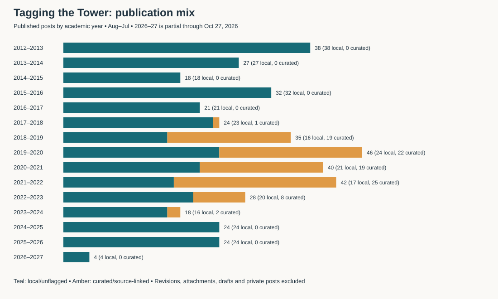
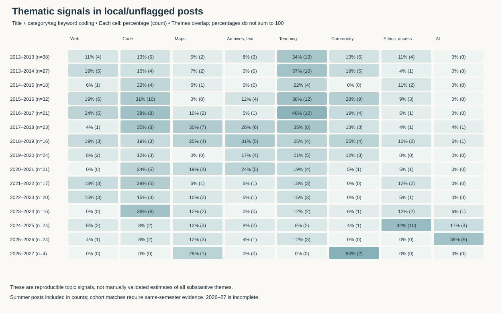

# Tagging the Tower: themes, cohorts, and editorial roles

**Author-credit correction, November 1, 2026:** Opening bylines and signed contributions have been re-audited. Eight records have corrected writer credits; two guest posts no longer inherit their posting account’s cohort match. The [correction report](ATTRIBUTION_REVIEW.html) documents all changes and unresolved attributions. The inventory and contributor tables supersede earlier attribution claims.

Interactive companion: [explore the charts](interactive_explorer.html), or read the [interactive usage and code guide](INTERACTIVE_GUIDE.html).

Analysis of `digitalinitiativesatthegradcenter.WordPress.2026-11-01.xml`, covering published posts dated September 2012–October 27, 2026. The export filename is November 1; it does not establish a complete 2026–27 academic year.

Update after further body-text analysis: participant credits for two 2016 posts and eleven collective authors for the 2025 Conversations reflection have been corrected in the inventory and contributor tables. Corpus totals and headline thematic counts are unchanged. See `deeper_reading.html` for additional findings and methods.

Computational extension: `nltk_mallet_report.html` presents NLTK stopword cleaning, lexical analysis, five actual MALLET LDA runs, seed/topic-count diagnostics, and eight additional visualizations. Its main corpus has 299 posts after explicit modeling exclusions; it complements the broader descriptive counts below.

## Findings

**The blog combines original writing, program communication, guest contributions, and web curation. Treating all entries as fellow-authored essays would substantially distort both production counts and cohort interpretations.** The export contains 421 published posts in the Tagging the Tower category, 9 drafts in that category, and 427 other items. Of the published category posts, 325 are local/unflagged and 96 are curated/source-linked. “Local/unflagged” means no detected curation markers; it is not a guarantee of original authorship or a claim that every item is an essay.

The strongest recent change is the visibility of AI: 4/24 local posts (16.7%) in 2024–25 versus 9/24 (37.5%) in 2025–26, an increase of 20.8 percentage points. Six of those nine later posts credit people listed in that year's signed Digital Fellows rosters; three credit other contributors. The change therefore reflects both cohort writing and a broader editorial network.

## Corpus and calendar

The XML has 857 items: 424 published ordinary posts, 11 draft ordinary posts, 1 private ordinary post, and 421 items of other types, including 300 attachments and 94 revisions. Only ordinary posts explicitly assigned the **category** `tagging-the-tower` enter this corpus. A similarly named tag does not independently qualify an item. The category includes 421 published and 9 draft posts. The remaining 3 published ordinary posts, 2 draft ordinary posts, and the private post are outside this category. Revisions are not additional posts.

Academic years run **August 1–July 31**. August–December is fall, January–May is spring, and June–July is marked summer. This supports fall–spring comparisons while retaining the seven summer posts in an explicit field. Summer publication does not establish summer fellowship membership. A September boundary would move August posts; these can be audited through the inventory. Dates use the original WordPress local publication date, not modification date, nomination date, or the date of an external source article.

| Academic year | Published | Local/unflagged | Curated/source-linked |
|---|---:|---:|---:|
| 2012–13 | 38 | 38 | 0 |
| 2013–14 | 27 | 27 | 0 |
| 2014–15 | 18 | 18 | 0 |
| 2015–16 | 32 | 32 | 0 |
| 2016–17 | 21 | 21 | 0 |
| 2017–18 | 24 | 23 | 1 |
| 2018–19 | 35 | 16 | 19 |
| 2019–20 | 46 | 24 | 22 |
| 2020–21 | 40 | 21 | 19 |
| 2021–22 | 42 | 17 | 25 |
| 2022–23 | 28 | 20 | 8 |
| 2023–24 | 18 | 16 | 2 |
| 2024–25 | 24 | 24 | 0 |
| 2025–26 | 24 | 24 | 0 |
| 2026–27, partial | 4 | 4 | 0 |
| **Total** | **421** | **325** | **96** |

The 2019–20 high point of 46 published entries contains only 24 local/unflagged posts. Likewise, the 42 entries in 2021–22 include 25 curated items (59.5%). These are changes in the mix of publishing activity, not direct measures of cohort productivity. The absence of detected curated items after 2023–24 concerns this export and these detection rules; it does not prove that fellows stopped curating elsewhere.

## Authorship, curation, and drafts

Attribution preserves three separate roles: the WordPress creator account, credited writer(s), and curator/source information. For locally published items, explicit guest bylines and the `author` taxonomy take precedence over the creator account. Where neither exists, creator-based authorship remains provisional. For source-linked/PressForward items, the creator is treated as the curator or posting account, and `item_author` is retained as external-source attribution. Generic values such as “Author on Source” remain unresolved.

The 96 curated/source-linked posts were posted under Param Ajmera (41), Kristen Hackett (28), Jessie McCormack (13), Di Yoong (5), Connor M French (3), Rebecca Krisel (3), Lisa Marie Rhody (2), and Filipa Calado (1). These are **curation-account counts**, not counts of essays written by those people. Some source-linked items recirculate material from related CUNY sites; the label does not require a non-CUNY source.

Examples that materially change cohort attribution:

| Post | Creator account | Credited writer | Interpretation |
|---|---|---|---|
| Thoughts on Situating AI Literacy, Feb. 2026 | Meha Gupta | Ian G. Williams | Explicit guest credit; not evidence that Meha wrote it or Ian belonged to the 2025–26 Digital Fellows roster |
| Vibe Coding My Way Out of a Teaching Problem, Apr. 2026 | Meha Gupta | Nicole Walker | Author taxonomy credits Nicole; not Meha-authored cohort writing |
| CityCamp NYC, Parts I and II, Oct. 2026 | Sophie Bala | Ian G. Williams | Two Ian-authored posts posted through Sophie's account; both people appear on the fall 2026 roster |
| A.I. Meets Critical Media Art, Feb. 2026 | Tuka Al-Sahlani | Jonah Brucker-Cohen | Contributor attribution, not Tuka authorship |
| Speculative Surveillance with Ring™ Log | Lisa Marie Rhody | Mark Sample, source metadata | Curated item and currently a draft; excluded from published trends |

There are 9 category drafts. Their dates must not be mistaken for publication evidence. These include *Installing WordPress locally on your Mac with MAMP*; *The CUNY Digital Humanities Resource Guide*; *When 'Retro' was 'Nowtro'*; *Inclusive Programming with Django and Python*; *Speculative Surveillance with Ring™ Log*; *Resource Guide for Video Tools in Distance Learning*; the Sourcegraph article; *Suspect Development Systems*; and *Reflecting on Alt Text*. The last is a draft dated April 3, 2025; the separately identified *Reflecting on Alt Text and its Ethics*, April 4, is published. Similar titles do not justify counting the draft or merging distinct post IDs.

## Cohort evidence

Membership is established from signed “your Digital Fellows” lists inside published welcome posts in the supplied XML. Posting in a particular year is not itself evidence of fellowship membership. The public GCDI site returned a CAPTCHA, so its historical roster pages could not be independently checked in this run. The evidence CSV retains each list's source post, URL, date, semester, and names as listed. Full names are expanded through the XML author directory where unambiguous; ambiguous first names remain unresolved.

These are **active-team snapshots**, not entering-cohort or appointment records. Annual membership below is the union of observed semester lists; it does not imply that every person served both semesters. Post matching is stricter: the credited writer must appear on the same-semester roster. Years without a signed list remain unconfirmed. The supplied export does not support a complete membership history for 2012–17 or fall 2017.

| Academic year | Membership evidence recovered |
|---|---|
| 2012–13 through 2016–17 | No signed cohort roster recovered; author activity is available but must not substitute for membership |
| 2017–18 | Spring: Hannah Aizenman, Tahir H. Butt, Kelsey Chatlosh, Kristen Hackett, Jojo Karlin, Jeremy March, Javier Otero Peña, Rachel Rakov, and two entries listed only as “Patrick.” The list alone does not disambiguate them. |
| 2018–19 | Fall: Filipa Calado, Javier Otero Peña, Kelsey Chatlosh, Kristen Hackett, Olivia Ildefonso, Pablo (surname unresolved), Patrick (surname unresolved), Rachel Rakov, Rafael Davis Portela, Stefano Morello. Spring list omits Kelsey and Pablo. |
| 2019–20 | Fall and spring: Filipa Calado, Javier Otero Peña, Kristen Hackett, Olivia Ildefonso, Rafael Davis Portela, Stefano Morello, Natalie O'Shea, Di Yoong, Connor M French, Param Ajmera |
| 2020–21 | Fall and spring: Connor M French, Di Yoong, Filipa Calado, Olivia Ildefonso, Param Ajmera, Rafael Davis Portela, Stefano Morello, Yuxiao Luo |
| 2021–22 | Fall and spring: Chelsea Lane, Di Yoong, Rebecca Krisel, Rilquer Mascarenhas, Param Ajmera, Leanne Fan, Zachary Lloyd, Yuxiao Luo |
| 2022–23 | Fall and spring: Leanne Fan, Nicole Cote, Rebecca Krisel, Rilquer Mascarenhas, Sam O'Hana, Silvia Rivera Alfaro, Yuxiao Luo, Zachary Lloyd |
| 2023–24 | Fall: Anna Corbett, Gregory Hartmann, Leanne Fan, Rebecca Krisel, Sam O'Hana, Silvia Rivera Alfaro, Tuka Al-Sahlani, Zachary Lloyd. Spring list omits Rebecca. |
| 2024–25 | Fall and spring: Anna Corbett, Chen Zhou, Maggie Schreiner, Parisa Setayesh, Peyton Cordero, Silvia Rivera Alfaro, Tuka Al-Sahlani, Zachary Lloyd |
| 2025–26 | Fall and spring: Anna Corbett, Pranav Chinmay (listed as Chinmay), Christopher Colon (Chris), Eunah Cho, Maggie Schreiner, Meha Gupta, Parisa Setayesh, Tuka Al-Sahlani |
| 2026–27 | Fall only: Zhilang, Shokran, Ian G. Williams, Meha Gupta, Sara, Peyton Cordero, Sophie Bala. Zhilang, Shokran, and Sara have unresolved surnames in this evidence. |

The [Graduate Center's funding description](https://www.gc.cuny.edu/fellowships-and-financial-aid/doctoral-student-funding/current-doctoral-student-funding) distinguishes GC Digital Fellows from Program Social Media Fellows and Videography Fellows. A guest contributor or participant in another GCDI program must not automatically be folded into a Digital Fellows cohort.

## Quantified themes

Eight overlapping dictionaries identify thematic signals in titles and exported categories/tags. The dictionaries, exact matched terms, post-level flags, counts, and denominators are supplied. Curation and drafts are excluded from the main thematic comparison. Unmatched posts remain uncoded rather than being forced into a topic. The categories are analytic groupings, not official WordPress categories. Categories/tags can have changed since initial publication; this is the export's snapshot.

This deliberately conservative headline/metadata measure reduces contamination from repeated welcome-post resource lists, copied source pages, and incidental mentions. It also misses themes expressed mainly in the body. The full-text version is supplied as a sensitivity check, **not** as a more accurate gold standard. No precision/recall estimate, independent coding validation, or statistical significance claim is made.

| Signal | 2023–24, n=16 | 2024–25, n=24 | 2025–26, n=24 |
|---|---:|---:|---:|
| AI & machine learning | 1 (6.3%) | 4 (16.7%) | 9 (37.5%) |
| Ethics, access & power | 2 (12.5%) | 10 (41.7%) | 0 (0%) |
| Maps & visualization | 2 (12.5%) | 3 (12.5%) | 3 (12.5%) |
| Archives, text & media | 0 (0%) | 2 (8.3%) | 1 (4.2%) |

**The zero for ethics in 2025–26 is a coding limitation, not evidence that ethical concern disappeared.** Full-text ethics/access/power terms occur in 17/24 posts that year (70.8%), versus 20/24 in 2024–25 (83.3%). Some are incidental or boilerplate, so those broader figures also require interpretation. Titles such as *The Walled Garden: Care and Containment in AI Research* and *When AI Makes Us More Active, We Risk Being Less Wise* show why “AI” and critical reflection cannot be treated as competing topics.

## Interpretation linked to people and cohorts

**2012–16: practical scholarly infrastructure and learning to work digitally.** Early posts address WordPress, academic identity, organizing research, software, web frameworks, and programming. Sam O'Hana's account contributes 16/38 local posts in 2012–13, 18/27 in 2013–14, and 11/18 in 2014–15. These concentrations mean an apparent annual “cohort theme” can reflect a prolific account. They are author-directory attributions from the current export; they do not independently verify historical appointments or names at the time of writing. The 2015–16 local corpus has code/computational signals in 10/32 posts (31.3%) and community/collaboration signals in 9/32 (28.1%). This suggests skills work coupled with collaborative research practice, rather than a purely individual tools narrative.

**2017–19: a wider methods repertoire alongside increasing curation.** In 2017–18, local posts show maps/visualization in 7/23 (30.4%) and archives/text/media in 6/23 (26.1%). Rachel Rakov, Kelsey Chatlosh, and Hannah Aizenman are prominent credited contributors, and all appear in the spring 2018 team list. Sound, text, and spatial methods broaden the blog's visible repertoire. In 2018–19, 19/35 published posts are curated, so a blended topic model would partly describe the material fellows selected from elsewhere. Curation is meaningful intellectual work, but evidence of selection differs from evidence of authored argument.

**2019–22: sustained methods support within a curation-heavy publishing model.** The signed lists establish overlapping teams around Filipa Calado, Di Yoong, Olivia Ildefonso, Param Ajmera, Rafael Davis Portela, Stefano Morello, and others. Local posts continue to cover archives, sound, programming, maps, and research support. The pandemic interpretation has independent institutional support: GCDI's [2020–21 annual report](https://files.commons.gc.cuny.edu/wp-content/blogs.dir/885/files/2022/03/GCDI_AR20-21sm.pdf) describes moving support and the research institute online. Publication counts alone cannot establish increased demand, improved outcomes, or a causal pandemic effect. For 2021–22 in particular, the 25 curated items should not be attributed as original essays to that year's eight-person roster.

**2022–24: overlapping web, mapping, code, and critical technology work.** Rebecca Krisel, Rilquer Mascarenhas, Silvia Rivera Alfaro, Leanne Fan, Sam O'Hana, and others appear in the 2022–23 lists. Silvia's WordPress series and Rilquer's spatial-data posts illustrate continuing practical instruction. The next year's Anna Corbett and Silvia posts connect maps and technologies to social questions: *Mapping and its Discontents*, *Geochicas*, *The smartwatch dilemma*, and *Digital tools and military technology–Reflections on AI amidst genocide*. These are concrete bridges between methods and critique. The narrower title/tag dictionaries only partly capture them.

**2024–25: ethical and political questions become unusually explicit in headlines and tags.** Ten of 24 local posts carry ethics/access/power signals. Contributions are distributed across multiple confirmed roster members: Maggie Schreiner's metadata posts, Peyton Cordero's racialized data discussion, Anna Corbett's surveillance and AI-cost posts, Silvia Rivera Alfaro's Anthropocene and alt-text pieces, and Parisa Setayesh's justice-oriented mapping and AI research pieces. This breadth supports a cohort-linked interpretation more strongly than a single prolific contributor would. Nevertheless, shared institutional priorities, editorial selection, changes to tagging, and wider public debates could also explain the pattern; cohort composition is not a causal explanation established by these records.

**2025–26: AI becomes an editorial center across an overlapping cohort and guest network.** Of nine AI-signaled local posts, six are attributed to confirmed roster members: Parisa Setayesh (3), Eunah Cho (2), and Meha Gupta (1). The other three credit Jonah Brucker-Cohen, Ian G. Williams, and Nicole Walker. Among the 19 local posts whose credited writers match same-semester cohort evidence, the AI share is 6/19 (31.6%). Among all 24 local posts it is 9/24 (37.5%). Keeping Parisa and Anna across the 2024–25 and 2025–26 rosters shows continuity alongside new voices; the shift should not be narrated as complete cohort replacement. Parisa's sequence moves from qualitative-research AI tools toward interpretive participation, containment, and literacy. Eunah's learning and wisdom posts add a pedagogical dimension. Guest writing widens this conversation without establishing membership.

**Fall 2026: early civic/public-interest technology signals, with a very small denominator.** Two of four published posts are Ian G. Williams's CityCamp pieces; one is Sophie's chart-design post and one is the welcome post. The two CityCamp posts therefore account for 50% of the year's observed local corpus and 100% of its civic/community headline signals. This is a specific author/event cluster, not yet a stable cohort-wide trend. The signed list places both Ian and Sophie on the fall roster, correcting the misleading impression that Sophie's creator account authored all four. The [CUNY PIT page](https://www.cuny.edu/research/research-development-programs/pit-at-cuny/) also identifies Williams as a Digital Fellow and links the 2026 CityCamp recap, independently corroborating that recent connection.

## What this analysis supports—and what remains open

The evidence supports an evolving combination of practical instruction, community infrastructure, critical reflection, and editorial curation, with a clear recent rise in explicitly AI-focused publishing. It does not support a simple transition from “technical” to “ethical”: ethical questions appear in earlier bodies, while technical work persists in recent years.

The supplied data do not establish complete early cohorts, appointment start/end dates, new-versus-returning status for all years, writers' disciplinary identities, editorial decision processes, readership, consultation demand, or program impact. Unmatched authors include guests, staff, alumni, unresolved identities, and years without roster evidence; “unconfirmed” does not mean “not a fellow.” Do not compute posts per fellow or compare cohort productivity using incomplete rosters. A historical roster or appointment list would allow the early membership gaps and ambiguous names to be resolved without changing the audited post inventory.

## Files and reproducibility

- `post_inventory.csv`: 430 category posts, including statuses, creator/credited-author fields, source links, date assignments, and membership-match status.
- `cohort_memberships_evidence.csv`: semester-level signed-list evidence; repeated people across semesters are intentional.
- `academic_year_summary.csv`: published/local/curated counts and eight local thematic counts by year.
- `contributors_by_year.csv`: local credited-writer activity and roster-matched counts; multi-author counts are non-exclusive.
- `theme_coding.csv`: post/theme pairs, exact title/tag matches, and full-text sensitivity flags.
- `audit.json`: corpus totals, source SHA-256, dictionaries, and roster snapshots.
- `records.json`: structured analysis records, without full post bodies or WordPress author email addresses.
- `analyze.py`: reruns the XML analysis using the Python standard library; it does not modify the source export.

The source file's SHA-256 is `ba4bb721c4f32b3340126f78e93f8b812e0ef79cd31810a9bc1c6f6dccb49ee7`.
