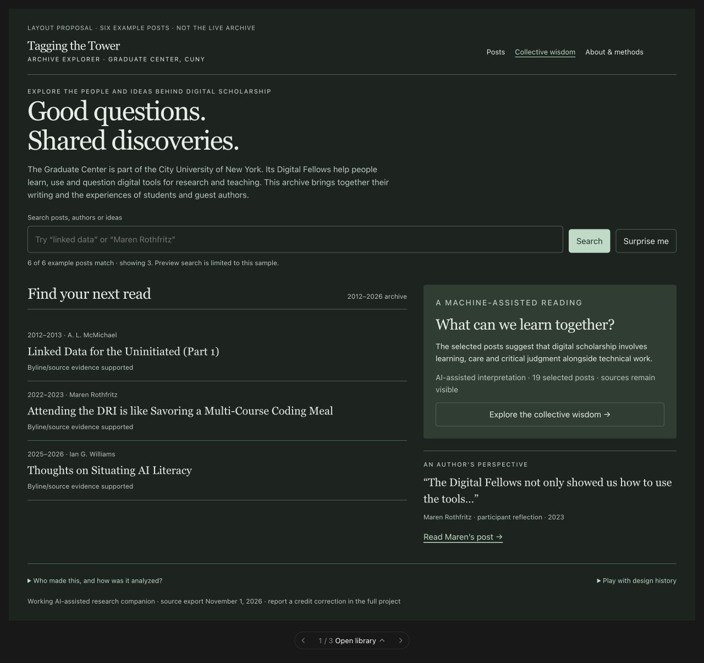
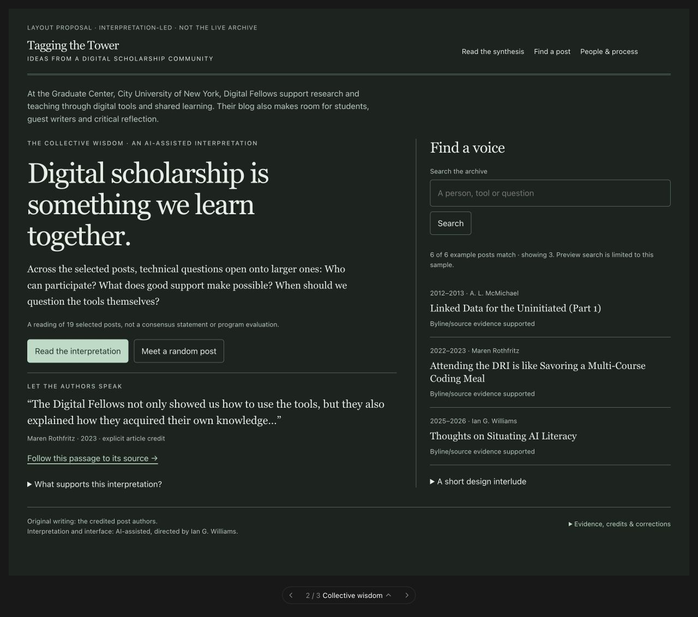
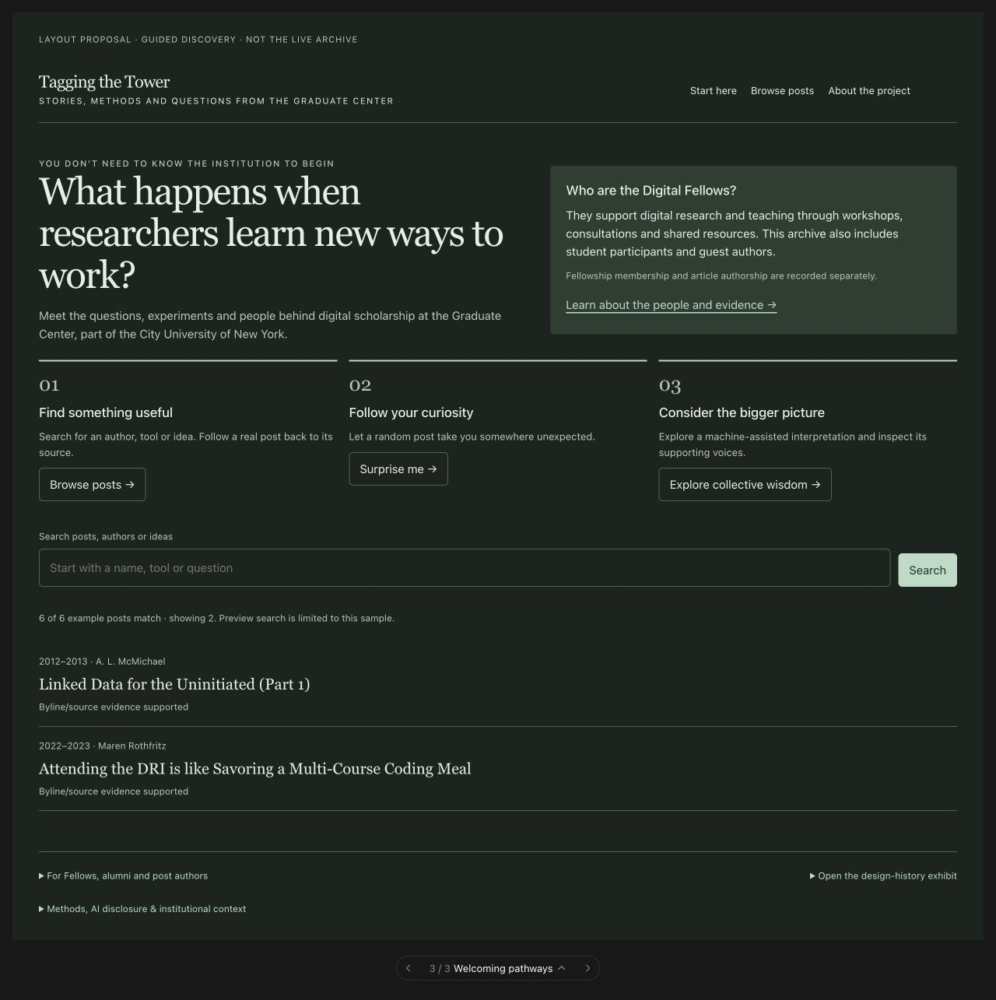

# Three public-first layout mockups

**Discussion prototypes only. The live site and fitted analysis are unchanged.** November 3, 2026.

Ian’s updated priorities put the general public first, followed by Fellows, alumni and post authors. Visitors should not need to know GCDI or the Graduate Center before they can understand the project, find a post, try random discovery or follow a machine-assisted synthesis back to its named sources. Other audiences remain supported through clear evidence, methods, contributor information and careful statements about outcomes.

## Open library

Search and random discovery lead; the synthesis is a visible supporting invitation. Best for quick access and repeat visits. Its tradeoff is that the interpretive project receives less initial attention. Design history survives as a footer disclosure rather than a studio competing with the archive.

## Collective wisdom

An editorial reading leads, with an author’s words and source alongside; search sits in a sidebar and random discovery remains visible. Best for communicating the synthesis, but it risks allowing the AI narrative to dominate the original voices. The 19-post selection, named author, original passage and limits are explicit. Design history becomes an optional editorial interlude.

## Welcoming pathways

Institutional orientation and three actions lead: browse/search, random discovery and collective interpretation. Best for a first-time public audience. Its tradeoff is an extra decision before the post list. Design history is a separate optional exhibit. This is the recommended starting direction for discussion, not an approved implementation.

## What is actually demonstrated

The in-conversation preview contains all three named variants, sample search, random draws, a source-grounded interpretation panel and three illustrative era treatments. Search/random use **six saved posts**, not the whole archive. Era treatments are sketches, not replacements for the existing sourced annual design catalog. The preview fragment requires the conversation renderer for its carousel and optional design controls; it is not a deployment-ready page. The screenshots are stable review references.

The mockups display the existing selected-post synthesis rather than claiming a new machine analysis was performed. Post 6755 is credited to Maren Rothfritz; the participant passage is quoted from the existing evidence. A participant account does not establish aggregate institutional outcomes. The full project’s authorship, cohort and model evidence remain separate.

Detailed options, input IDs, source revision, provenance and checks are in [layout_options.json](layout_options.json). The active backlog remains in [simplification_backlog.md](../simplification_backlog.md); its priority basis is updated, but no proposed website revision is automatically approved by this exercise.

## Contribution and checks

Human — Ian supplied audience priorities, core tasks, quality/interpretability requirements and the request for three non-production mockups (CRediT: Conceptualization, Methodology, Project administration). AI — OpenAI Codex drafted the alternatives, generated prototype code and visuals, reused saved evidence and performed browser/source checks (GAIDeT: Code generation 0000017; Visualization 0000027; Text generation 0000030; Validation 0000023; Recommendations 0000047). Exact model/build is not recorded. No additional reviewer agents or human usability participants were used.

JavaScript syntax, unique element IDs, sample search and random behavior, an interpretation/source panel and an era selector were checked. All three options were visually inspected in the default desktop dark appearance with no console errors. Narrow-screen behavior, formal accessibility and user preference remain untested. Annotated production methods and data-quality controls remain requirements for a later authorized implementation.
